# MiGasto-KMP

Nueva versión de [MiGasto](https://github.com/VMichael1999/MiGasto), la app que anota tus pagos de Yape, Plin y Google Wallet sin que los escribas. Todo se guarda solo en tu teléfono, cifrado, sin cuentas ni servidor.

Esta versión reparte el trabajo así:

- `shared` (Kotlin Multiplataforma): la lógica, escrita una sola vez para los dos sistemas. Incluye el lector de pagos, las categorías, la protección contra duplicados, la base de datos cifrada, el respaldo `.mgb` y la exportación a CSV, con sus tests.
- `androidApp` (Kotlin + Jetpack Compose): la interfaz en Material 3 y lo propio de Android: lectura de notificaciones, la ventana flotante con cuenta regresiva y los avisos con botones.
- `iosApp` (Swift + SwiftUI): la interfaz con la barra Liquid Glass de iOS 26 y lo propio de iPhone: compartir capturas de Yape que se leen con Vision, registro de Apple Pay con Atajos, widget y Face ID.

Las dos apps se ven como MiGasto (la misma tipografía Outfit, el mismo verde y los mismos textos), pero cada una usa los controles de su sistema.

## Estado

| Parte | Estado |
|---|---|
| `shared` (lógica, base cifrada, respaldo, CSV) | **Hecho**, con 545 tests y 98 % de cobertura de líneas |
| `androidApp` (7 pantallas, lectura de pagos, ventana flotante) | **Hecho**, con 62 pruebas de interfaz y bloqueo con huella o PIN; faltan algunas pantallas secundarias (ver abajo) |
| `iosApp` (SwiftUI) | **Hecho en el simulador**: las 7 pantallas, base cifrada con Keychain, Face ID, ubicación con mapa, compartir capturas con Vision, Atajos para Apple Pay y widget; sin probar en un iPhone real |

La versión original en Flutter sigue en [su repo](https://github.com/VMichael1999/MiGasto) y es la referencia de comportamiento: la lógica de aquí se portó de allí, con los tests primero.

## Android

Capturas del emulador con los datos de ejemplo del diseño (`docs/diseno/migasto-kmp.html`); los montos cuadran: ingresos S/ 2,800.00, gastos S/ 144.70, quedan S/ 2,655.30, por confirmar S/ 230.00 y presupuesto S/ 1,500 con el 10 % usado.

| Resumen | Movimientos | Nuevo movimiento | Detalle |
|---|---|---|---|
|  |  |  |  |

| Reportes | Ajustes | Ventana flotante | Aviso de pago |
|---|---|---|---|
|  |  |  |  |

También hay capturas en oscuro, con los montos ocultos y de cada hoja y diálogo en [`docs/comparacion/`](docs/comparacion).

### Cómo entra un pago

```text
notificación de Yape/Plin/Wallet ──► PaymentNotificationListener ──┐
pantalla de la constancia de Yape ─► ServicioDeAccesibilidad ──────┤
                                                                   ▼
                                                   ProcesadorDePagos  (shared)
                                  lee el texto · ¿proveedor activo? · ¿constancia ya leída?
                                                · ¿mismo pago por otra vía en 2 min?
                                                                   ▼
                              teléfono en uso ──► ventana flotante (4 s en «Guardar»)
                              pantalla apagada ─► se guarda y avisa con «Guardar» / «Ignorar»
                                                                   ▼
                                              RegistroDeMovimientos ► base cifrada
```

Lo que en la app de Flutter eran dos lectores de reglas (Dart y Kotlin) y una cola de JSON ahora es un solo código en `shared`: el código nativo de Android solo entrega el texto y dibuja.

## iPhone

El Resumen, Movimientos, Nuevo movimiento, Detalle, Reportes, Ajustes y Dónde pagaste de iPhone usan los mismos montos, reglas y textos que Android: los pone `shared` (`PantallaDelResumen`, `PantallaDeMovimientos`, `FormularioNuevoMovimiento`, `SeguimientoDelDetalle`, `SeguimientoDeReportes`, `SeguimientoDeAjustes`, `SeguimientoDeDondePagaste`) y SwiftUI solo los dibuja, con la barra de pestañas de iOS 26 (Liquid Glass).

| Resumen | Resumen oscuro, montos ocultos | Movimientos | Hoja de filtros |
|---|---|---|---|
|  |  |  |  |

| Nuevo movimiento | Nueva categoría | Detalle |
|---|---|---|
|  |  |  |

| Reportes (mes) | Reportes (rango) | Detalle con ubicación |
|---|---|---|
|  |  | 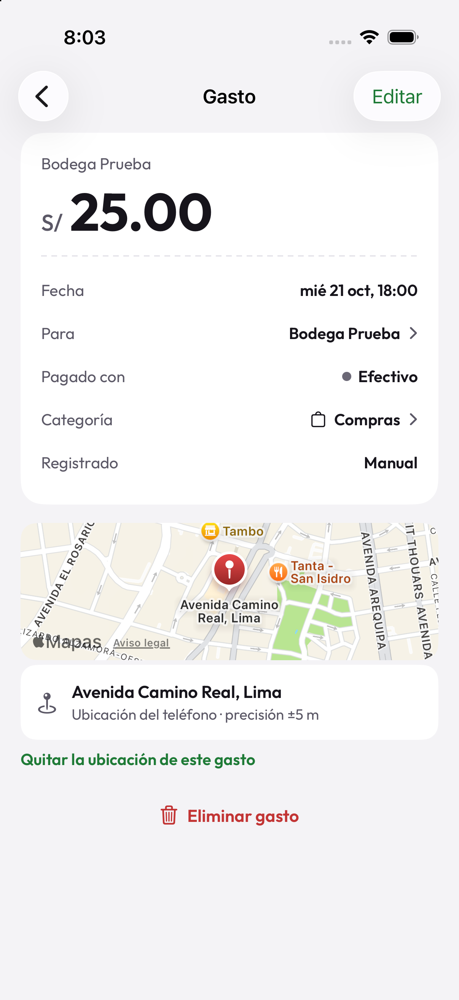 |

| Ajustes | Respaldo cifrado creado | Bloqueo con Face ID | Dónde pagaste |
|---|---|---|---|
|  |  | 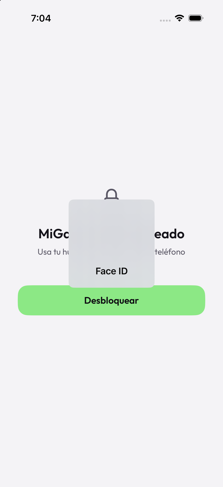 | 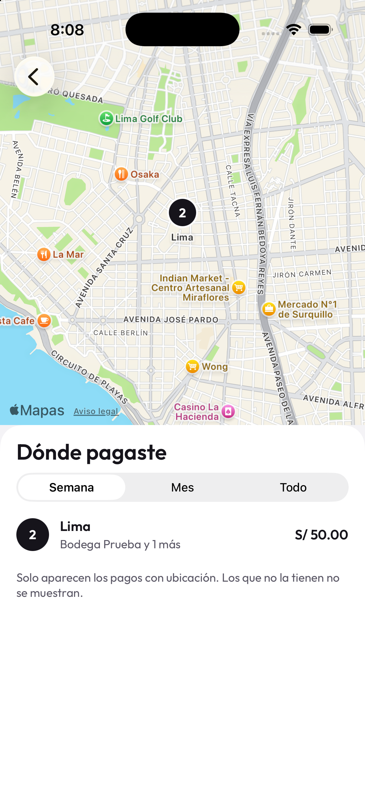 |

### Compartir capturas (iPhone)

La extensión «Compartir» (`iosApp/MiGastoCompartir`) recibe una captura, lee su texto con Vision en el teléfono y abre una hoja como la del diseño: «Cancelar» y «Guardar» arriba, «Leído en tu iPhone, sin internet», el monto, el comercio, la fuente y la categoría (la sugerida por las reglas, que se puede cambiar). Si la imagen no es la constancia de un pago, lo dice y no guarda nada. Al guardar, deja el texto y la categoría elegida en una cola de la carpeta compartida de la app (`group.com.migasto.ios`). La extensión no abre la base cifrada ni su clave: usa `shared` solo para leer el texto (`vistaPreviaDeCaptura`, 8 pruebas). Al abrir MiGasto, la app registra lo pendiente con `RecibidorDeCapturas` (las mismas reglas que la lectura de pantalla de Android: solo cuenta la constancia, lo ya leído no se repite y los proveedores apagados se ignoran) y borra el archivo. De cada captura solo se guardan los primeros 1500 caracteres de texto, no la imagen.

| La hoja de la extensión | El pago ya registrado (categoría «Servicios», la que se eligió) |
|---|---|
| 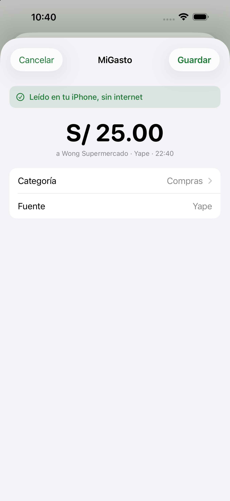 | 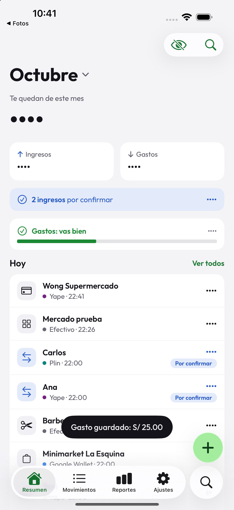 |

### Apple Pay con Atajos (iPhone)

La acción «Registrar movimiento» (`App Intents`, en `iosApp/MiGasto/AtajosYWallet`) es la que la automatización «Transacción» de Wallet llama al pagar con Apple Pay: recibe el monto, el comercio, la tarjeta y, si quieres, la ubicación, y guarda el gasto sin abrir la app. Qué se lee del monto (`25.50`, `S/ 25,50`, `1,200.50`), cómo se guarda y qué se contesta lo decide `RegistradorDeWallet` de `shared`, con 7 pruebas. Aparece en la app Atajos bajo «MiGasto». **Sin verificar de punta a punta:** el simulador, con la firma ad hoc que usa este proyecto, rechaza la conexión de la app con Atajos (`requiresValidBundle`), así que la ejecución real de la acción queda por probar con una firma de desarrollador o en un iPhone.

### Widget (iPhone)

`iosApp/MiGastoWidgets` trae el widget «Registrar movimiento» (pantalla de inicio y de bloqueo) y un control para el Centro de control. Los dos abren la app con `migasto://new`, el mismo esquema que usaba Flutter; `EnlacesDeLaApp` de `shared` decide si un enlace pide abrir «Nuevo movimiento» (3 pruebas). Se vio el widget en la galería del simulador y el enlace abriendo «Nuevo movimiento»; no lo probé puesto en la pantalla de inicio ni el control del Centro de control.

| Widget en la galería |
|---|
| 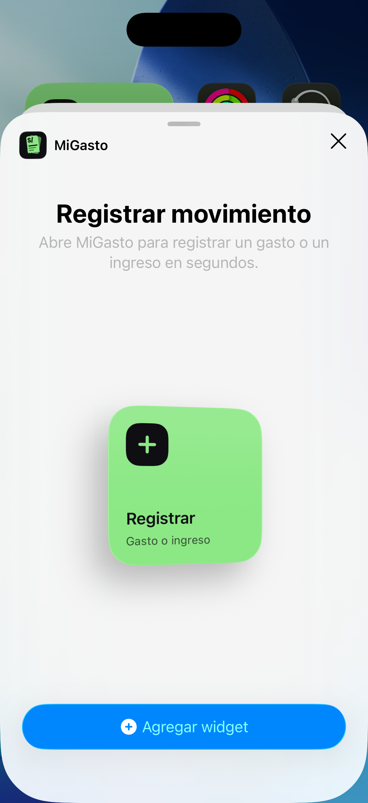 |

### Barra y búsqueda (iPhone)

La barra inferior sigue el diseño: las cuatro pestañas en el vidrio del sistema y la lupa aparte, con el «+» de vidrio verde flotando justo encima de ella. La lupa abre una búsqueda que ya trae el teclado y busca entre **todos** los movimientos, por comercio o nombre guardado (`BusquedaGlobal` de `shared`, 6 pruebas); el ojo y la lupa del Resumen llevan a la misma búsqueda y «Ver todos» lleva a Movimientos. Movimientos ya no tiene su propia búsqueda: queda el filtro por tipo y la hoja de filtros. Los íconos de la barra (de contorno o rellenos) y el «lente» de la pestaña activa los dibuja el sistema, así que se ven como el iOS del teléfono y no calcados del HTML.

| Resumen | Movimientos | Búsqueda |
|---|---|---|
| 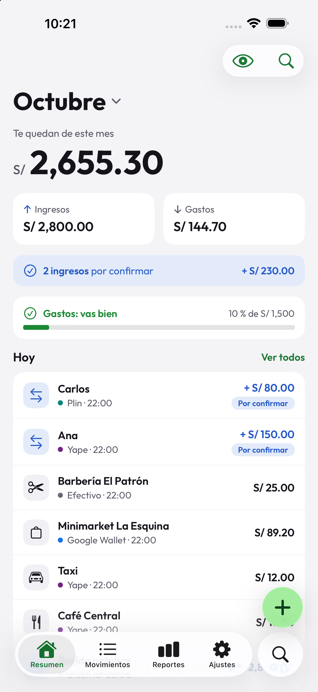 | 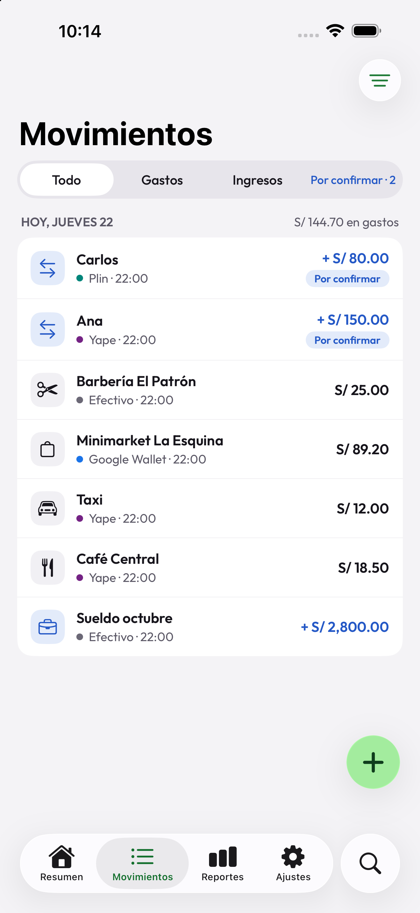 | 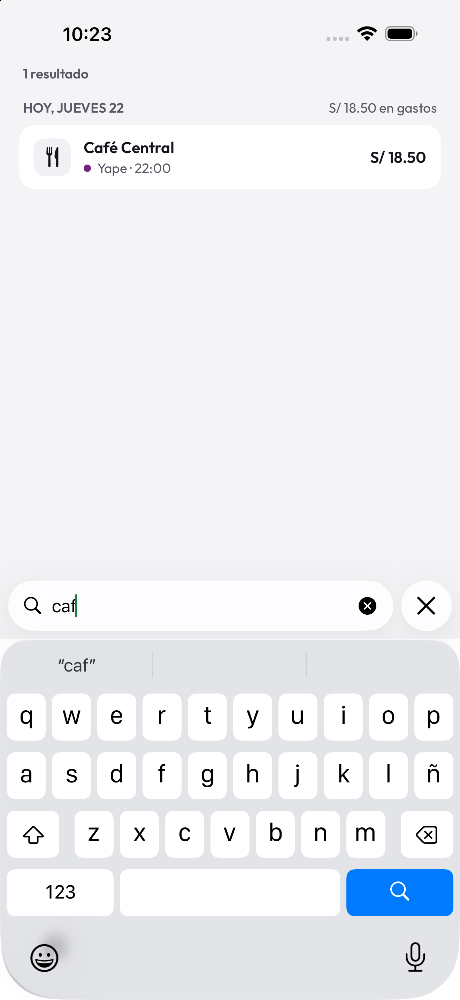 |

### Nuevo movimiento y Detalle (iPhone)

«Nuevo movimiento» ahora es una hoja de iOS (con la barra gris de arrastre): «Cancelar» y «Guardar» arriba (Guardar se activa con monto y nota), el monto, una tarjeta con «Nota» y «Pagado con», las categorías en cuadrícula de tres y el teclado sin fondo en las teclas. Ya no hay botón grande abajo. El Detalle trae «‹ Resumen» (o «‹ Movimientos», o «‹ Buscar»: el nombre de la pantalla de donde se vino) y «Editar» en verde; el gesto de deslizar desde el borde para volver sigue funcionando.

| Nuevo movimiento | Detalle |
|---|---|
| 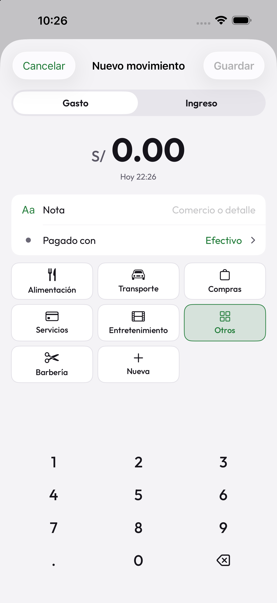 | 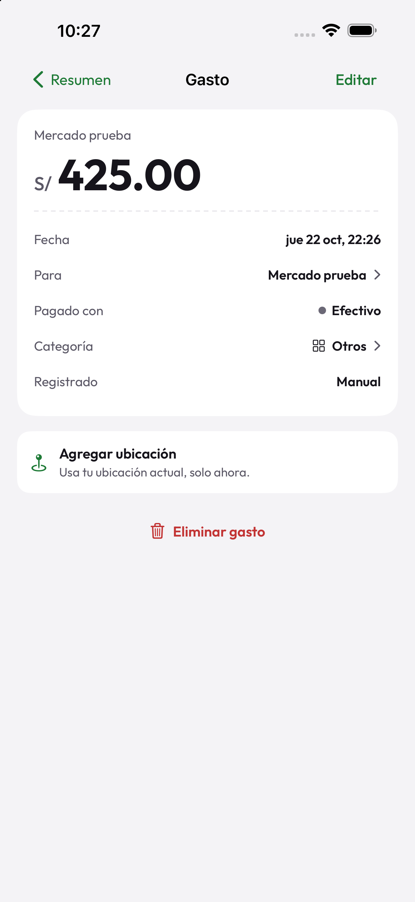 |

### Ajustes (iPhone)

Ajustes sigue el diseño: **Registro en iPhone** (Compartir capturas de Yape y Plin, Apple Pay con Atajos, Avisos de pagos), **Seguridad** (Bloquear con Face ID y «Ocultar montos al abrir»), y debajo lo demás que ya existía (registro automático, «Dónde pagaste» y Tus datos). Las dos primeras filas abren los pasos para usarlas (la de Atajos con un botón que abre la app Atajos). «Avisos de pagos» pide el permiso de notificaciones la primera vez y lleva a los ajustes del sistema después; la acción de Atajos avisa cuando registra un pago de Apple Pay, y con «Monto en pantalla bloqueada» apagado el aviso solo dice «Pago detectado». «Ocultar montos al abrir» se guarda en la base (`RepositorioAjustes`) y la app abre con los montos ocultos. Los textos salen de `TextosDeAjustesDeIphone`, en `shared`. «Compartir capturas» y «Apple Pay con Atajos» no se pueden saber desde la app si están usándose, por eso muestran «Activo» y «Configurar» fijos.

| Ajustes | Apple Pay con Atajos |
|---|---|
| 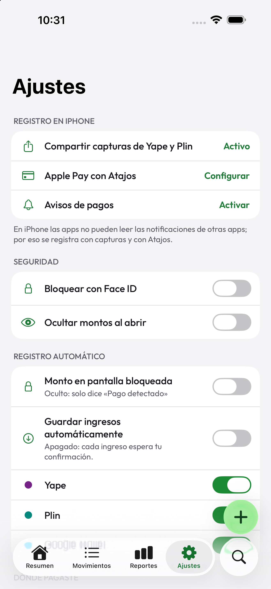 | 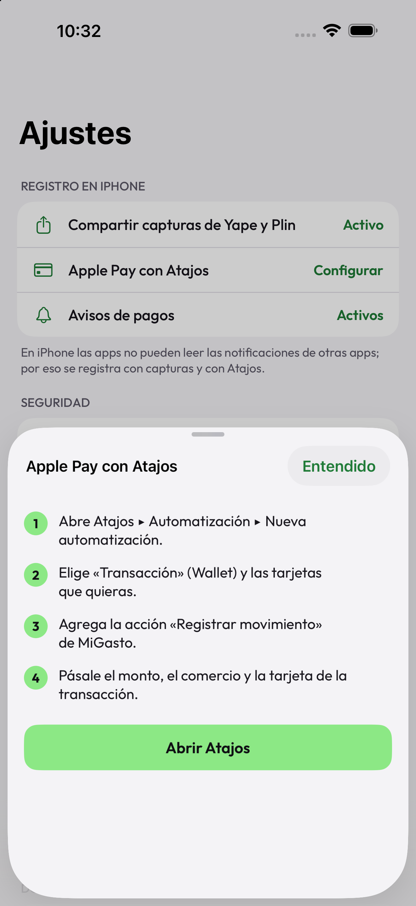 |

## Arquitectura

```text
MiGasto-KMP/
├── shared/            Kotlin Multiplataforma (Android, iOS y JVM para probar)
│   ├── commonMain/    dominio, reglas, repositorios, casos de uso, respaldo y CSV
│   ├── androidMain/   base con SQLCipher y almacén de la clave en el Keystore
│   ├── iosMain/       base con SQLCipher y almacén de la clave en el Keychain
│   └── reglas/        reader_rules.json y category_rules.json (los mismos que usa Flutter)
├── androidApp/        Jetpack Compose, ViewModels con StateFlow y la capa nativa
├── iosApp/            SwiftUI; el framework de shared entra por CocoaPods
└── docs/              diseño de referencia, capturas y notas de compatibilidad
```

- **Las vistas no calculan nada.** Cada pantalla recibe el texto ya armado: el saldo y los porcentajes (`ResumenDelMes`), los días y filtros (`ListaDeMovimientos`), la boleta (`DetalleDelMovimiento`), los reportes (`Reporte`), el formulario (`FormularioNuevoMovimiento`) y la ventana flotante (`SesionDeVentana`). Android e iPhone muestran lo mismo.
- **Base cifrada.** SQLDelight con SQLCipher en Android e iOS, con esquema versionado (`shared/schemas`) y la primera migración real (v1 → v2). La clave se genera en el teléfono y vive en el Keystore o el Keychain.
- **Respaldo `.mgb` compatible byte a byte con Flutter** (AES-256-GCM, PBKDF2 de 210 000 vueltas), probado en las dos direcciones. Ver [`docs/compatibilidad-respaldo.md`](docs/compatibilidad-respaldo.md).
- **Sin servidor ni cuentas.** Todo queda en el teléfono.

### Decisiones y dependencias

| Tema | Elección |
|---|---|
| Base de datos | SQLDelight 2.4 + SQLCipher (en iOS se compila desde Gradle para que gane al SQLite de Apple) |
| Fechas, JSON, corrutinas | kotlinx-datetime, kotlinx-serialization, kotlinx-coroutines |
| Cifrado del respaldo | [cryptography-kotlin](https://github.com/whyoleg/cryptography-kotlin) 0.6 (aprobada aparte: no está en la tabla inicial) |
| Interfaz de Android | Compose (BOM 2026.09), Material 3, ViewModel, Vico 3 para los gráficos, BiometricPrompt (androidx.biometric 1.1, de la tabla del prompt) para el bloqueo |
| Tipografía | Outfit empaquetada, licencia OFL en [`docs/licencias`](docs/licencias) |
| Calidad | ktlint, Kover (mínimo 80 % en `shared`), Compose Testing |

## Pruebas y calidad

```bash
./gradlew :shared:jvmTest                       # tests de la lógica compartida, en el computador
./gradlew :shared:iosSimulatorArm64Test         # los mismos, en el simulador de iPhone
./gradlew :shared:connectedAndroidDeviceTest    # los mismos, en un emulador o teléfono Android
./gradlew :androidApp:connectedDebugAndroidTest # pruebas de interfaz con Compose Testing
./gradlew :shared:koverVerify                   # cobertura de shared (mínimo 80 %)
./gradlew :shared:ktlintCheck :androidApp:ktlintCheck
```

- **545 tests de `shared`** corren en las tres plataformas (JVM, iOS y Android). Casi todos son los de Flutter, portados primero, más los casos nuevos.
- **62 pruebas de interfaz** en `androidApp`: la bienvenida, «Dónde pagaste», Resumen (con el menú de meses), Movimientos (con la hoja de filtros), Nuevo movimiento (con el teclado), la ventana flotante (botones, cuenta regresiva, pausa y deslizar) y el bloqueo (con un autenticador falso).
- La CI (`.github/workflows/shared.yml`) corre el estilo, la cobertura, los tests de `shared` en iOS, la compilación de `iosApp` (app y extensiones, para el simulador y sin firma) y los tests de Android en un emulador. El job de `iosApp` se probó en un clon limpio de este Mac con los mismos comandos; en GitHub aún no corrió (no se hizo push), así que depende de que `macos-latest` traiga un Xcode con iOS 26.

## Cómo correrlo

Se necesita JDK 21 o más nuevo, el SDK de Android (`ANDROID_HOME`) y, para iOS, Xcode y CocoaPods.

```bash
./gradlew :androidApp:installDebug
```

La versión de depuración trae datos de ejemplo (los del diseño) si la base está vacía; la de producción (`assembleRelease`) arranca vacía. Para probar la lectura de pagos sin Yape, la versión de depuración también lee las notificaciones del shell:

```bash
adb shell cmd notification allow_listener com.migasto/com.migasto.android.pagos.PaymentNotificationListener
adb shell "cmd notification post -S bigtext -t 'Yape' prueba1 'Yapeaste S/ 32.00 a Cafe Central'"
```

### iPhone

Se necesita Xcode (con el simulador de iOS 26 o más nuevo) y CocoaPods. El proyecto de Xcode se genera con un script (no hay que instalar XcodeGen):

```bash
./gradlew :shared:generateDummyFramework
python3 scripts/generar-proyecto-xcode.py   # solo si se agregaron archivos Swift
cd iosApp && pod install
open MiGasto.xcworkspace
```

En un clon limpio, antes de `pod install` hace falta `./gradlew :shared:podspec :shared:generateDummyFramework`, y para compilar sin un simulador elegido hay que pasar `ARCHS=arm64` (el framework de Kotlin solo se genera para arm64). Al compilar, la pod `shared` construye el framework con Gradle. La versión de depuración trae los datos de ejemplo del diseño si la base está vacía; la de producción no los compila.

### Mapa (opcional)

Para ver el mapa de «Dónde pagaste» y el mapa chico del detalle, pon tu clave de Google Maps (de [Google Cloud](https://console.cloud.google.com), con «Maps SDK for Android» activado) en `local.properties`, que no se sube al repositorio:

```properties
GOOGLE_MAPS_API_KEY=tu-clave
```

También sirve la variable de entorno `GOOGLE_MAPS_API_KEY`. Sin clave todo lo demás funciona.

## Qué falta

- **iPhone** (`iosApp`): todas las pantallas y piezas planeadas ya están (incluidos «Agregar ubicación», «Dónde pagaste» con el mapa de Apple, el bloqueo con Face ID, compartir capturas con Vision, la acción de Atajos para Apple Pay y el widget). Todo se probó en el simulador, con ubicación y Face ID simulados, y nada en un iPhone real. Falta una app de CI para iOS que compile `iosApp`: hoy el CI solo prueba `shared` en iOS.
- **Mapa de Google sin probar:** «Agregar ubicación» y «Dónde pagaste» están hechos y probados en el emulador, pero el mapa solo se dibuja con una clave de Google Maps (ver «Cómo correrlo») y no tengo una para probarlo: sin clave la app lo explica en vez de mostrar un mapa en blanco.
- **Sin verificar de verdad:** la acción de Atajos para Apple Pay corriendo de verdad, la lectura de una constancia real de Yape en pantalla, el comportamiento en un teléfono físico y TalkBack con texto al 200 %.
- **Keychain de iOS:** el código compila, pero sus pruebas solo pueden correr dentro de una app anfitriona (la de `iosApp`).
