# MiGasto-KMP

Nueva versión de [MiGasto](https://github.com/VMichael1999/MiGasto), la app que anota tus pagos de Yape, Plin y Google Wallet sin que los escribas. Todo se guarda solo en tu teléfono, cifrado, sin cuentas ni servidor.

Esta versión reparte el trabajo así:

- `shared` (Kotlin Multiplataforma): la lógica, escrita una sola vez para los dos sistemas. Incluye el lector de pagos, las categorías, la protección contra duplicados, la base de datos cifrada, el respaldo `.mgb` y la exportación a CSV, con sus tests.
- `androidApp` (Kotlin + Jetpack Compose): la interfaz en Material 3 y lo propio de Android: lectura de notificaciones, la ventana flotante con cuenta regresiva y los avisos con botones.
- `iosApp` (Swift + SwiftUI): la interfaz con la barra Liquid Glass de iOS 26 y lo propio de iPhone: compartir capturas de Yape que se leen con Vision, registro de Apple Pay con Atajos, widget y Face ID.

Las dos apps se ven como MiGasto (la misma tipografía Outfit, el mismo verde y los mismos textos), pero cada una usa los controles de su sistema.

## Estado

| Parte | Estado |
|---|---|
| `shared` (lógica, base cifrada, respaldo, CSV) | **Hecho**, con 505 tests y 98 % de cobertura de líneas |
| `androidApp` (7 pantallas, lectura de pagos, ventana flotante) | **Hecho**, con 62 pruebas de interfaz y bloqueo con huella o PIN; faltan algunas pantallas secundarias (ver abajo) |
| `iosApp` (SwiftUI) | **En marcha**: proyecto, base cifrada con Keychain, Resumen, Movimientos, Nuevo movimiento, Detalle y Reportes; faltan las demás pantallas |

La versión original en Flutter sigue en [su repo](https://github.com/VMichael1999/MiGasto) y es la referencia de comportamiento: la lógica de aquí se portó de allí, con los tests primero.

## Android

Capturas del emulador con los datos de ejemplo del diseño (`docs/diseno/migasto-kmp.html`); los montos cuadran: ingresos S/ 2,800.00, gastos S/ 144.70, quedan S/ 2,655.30, por confirmar S/ 230.00 y presupuesto S/ 1,500 con el 10 % usado.

| Resumen | Movimientos | Nuevo movimiento | Detalle |
|---|---|---|---|
| 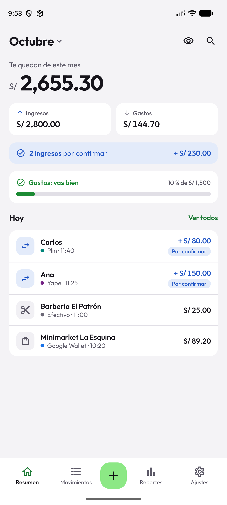 | 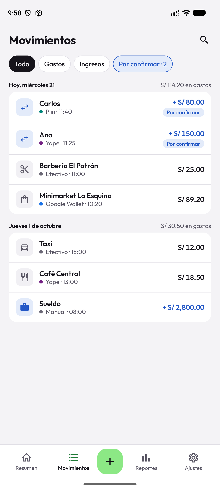 | 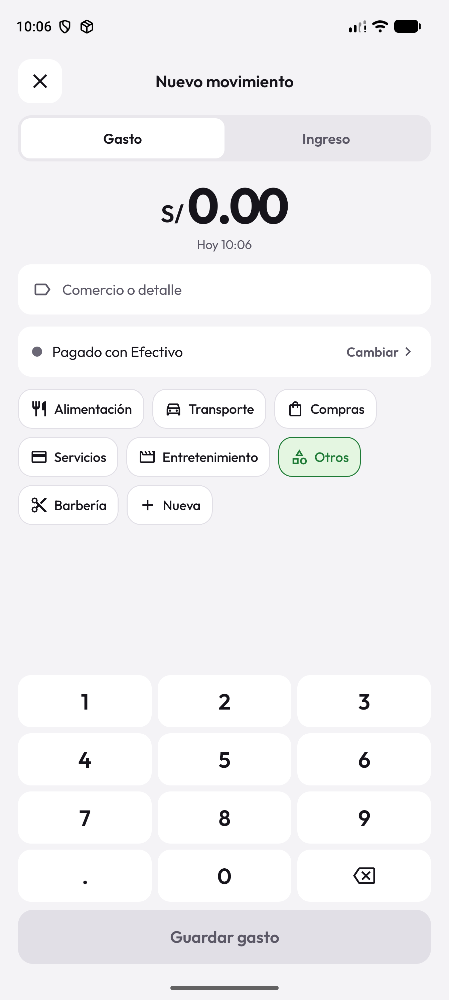 | 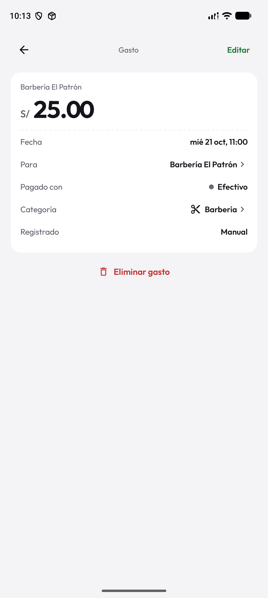 |

| Reportes | Ajustes | Ventana flotante | Aviso de pago |
|---|---|---|---|
| 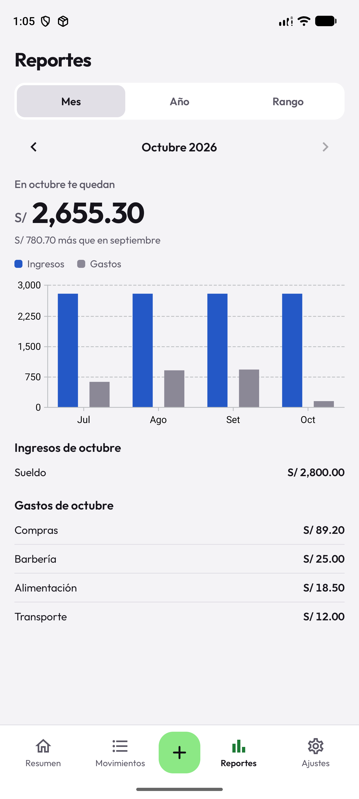 | 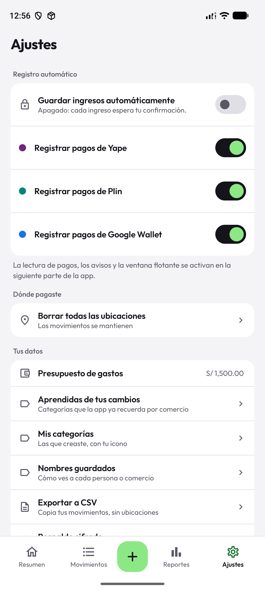 | 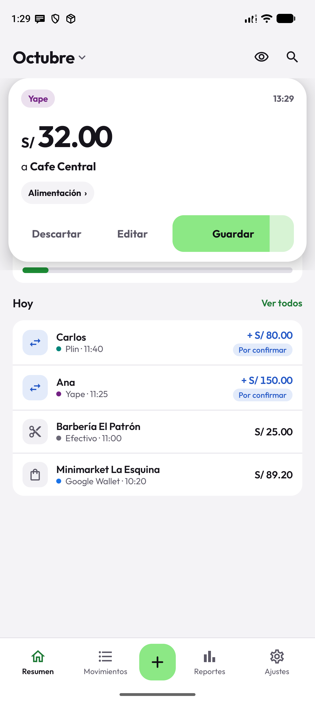 | 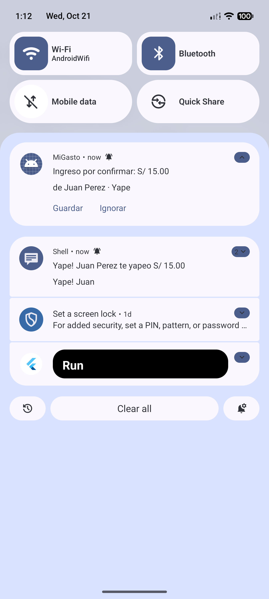 |

También hay capturas en oscuro, con los montos ocultos y de cada hoja y diálogo en [`docs/comparacion/`](docs/comparacion).

### Cómo entra un pago

```text
notificación de Yape/Plin/Wallet ──► PaymentNotificationListener ──┐
pantalla de la constancia de Yape ─► ServicioDeAccesibilidad ──────┤
                                                                   ▼
                                                   ProcesadorDePagos  (shared)
                                  lee el texto · ¿proveedor activo? · ¿constancia ya leída?
                                                · ¿mismo pago por otra vía en 2 min?
                                                                   ▼
                              teléfono en uso ──► ventana flotante (4 s en «Guardar»)
                              pantalla apagada ─► se guarda y avisa con «Guardar» / «Ignorar»
                                                                   ▼
                                              RegistroDeMovimientos ► base cifrada
```

Lo que en la app de Flutter eran dos lectores de reglas (Dart y Kotlin) y una cola de JSON ahora es un solo código en `shared`: el código nativo de Android solo entrega el texto y dibuja.

## iPhone

El Resumen, Movimientos, Nuevo movimiento, Detalle, Reportes y Ajustes de iPhone usan los mismos montos, reglas y textos que Android: los pone `shared` (`PantallaDelResumen`, `PantallaDeMovimientos`, `FormularioNuevoMovimiento`, `SeguimientoDelDetalle`, `SeguimientoDeReportes`, `SeguimientoDeAjustes`) y SwiftUI solo los dibuja, con la barra de pestañas de iOS 26 (Liquid Glass).

| Resumen | Resumen oscuro, montos ocultos | Movimientos | Hoja de filtros |
|---|---|---|---|
| 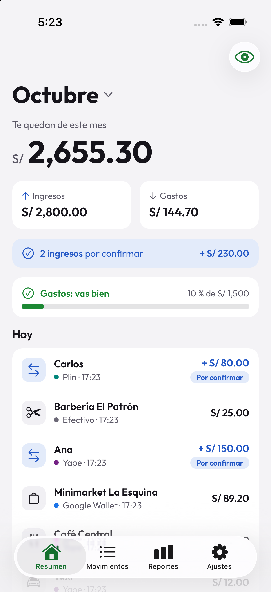 | 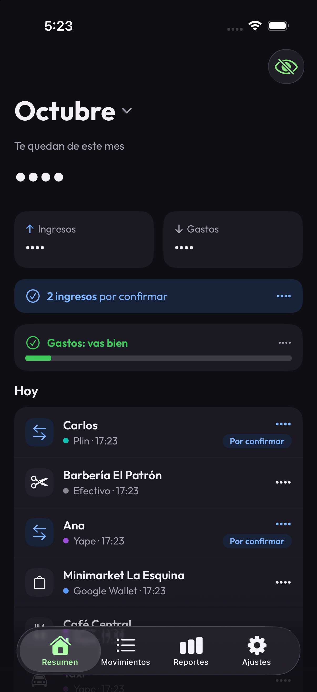 | 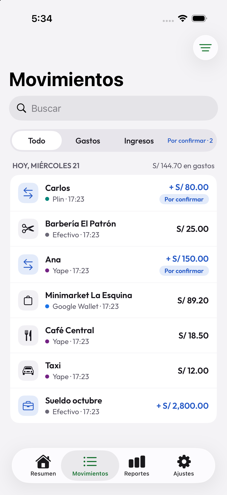 | 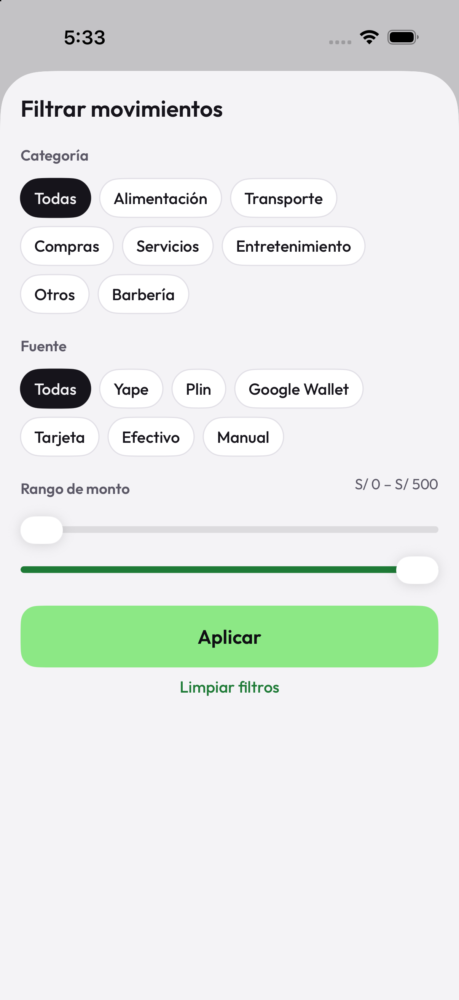 |

| Nuevo movimiento | Nueva categoría | Detalle |
|---|---|---|
| 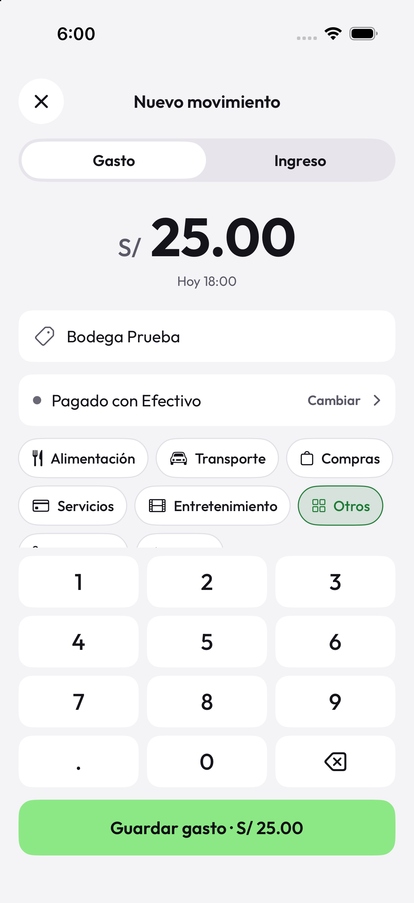 | 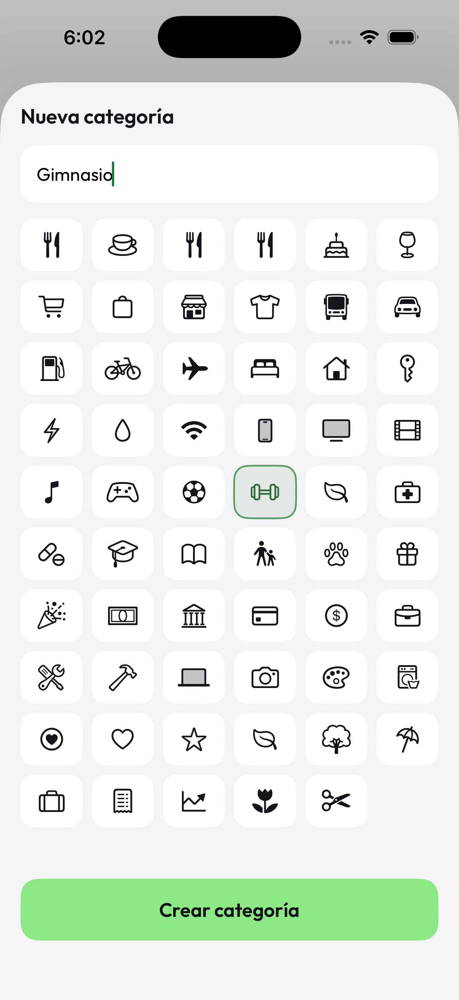 | 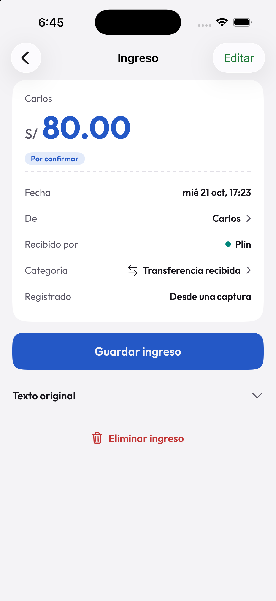 |

| Reportes (mes) | Reportes (rango) |
|---|---|
| 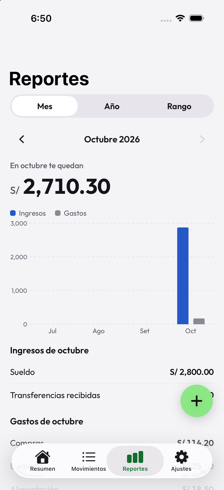 | 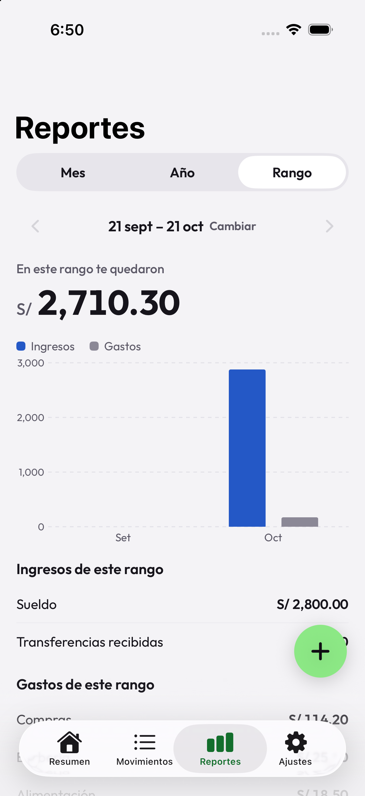 |

| Ajustes | Respaldo cifrado creado |
|---|---|
| 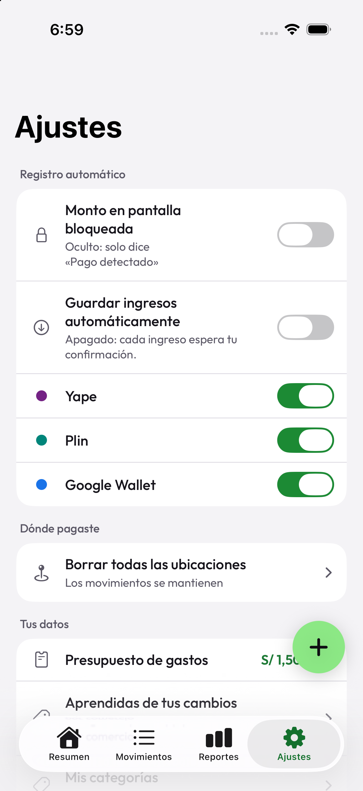 | 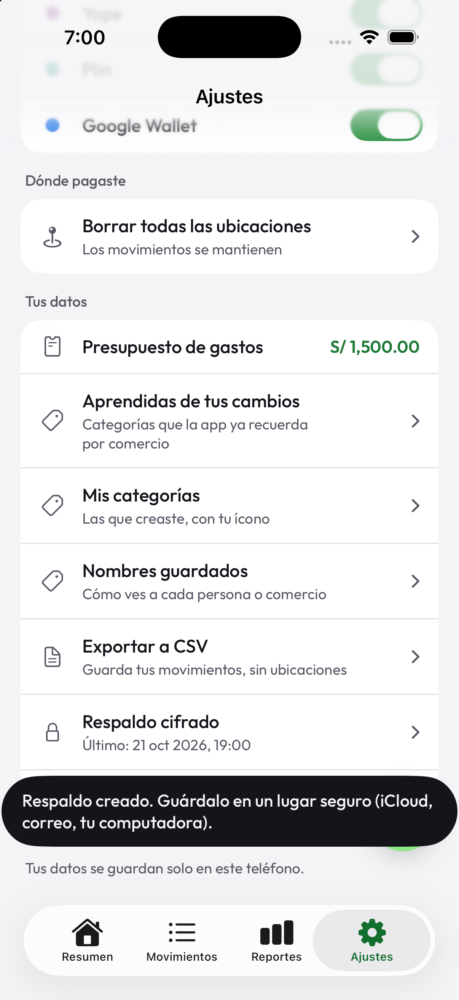 |

## Arquitectura

```text
MiGasto-KMP/
├── shared/            Kotlin Multiplataforma (Android, iOS y JVM para probar)
│   ├── commonMain/    dominio, reglas, repositorios, casos de uso, respaldo y CSV
│   ├── androidMain/   base con SQLCipher y almacén de la clave en el Keystore
│   ├── iosMain/       base con SQLCipher y almacén de la clave en el Keychain
│   └── reglas/        reader_rules.json y category_rules.json (los mismos que usa Flutter)
├── androidApp/        Jetpack Compose, ViewModels con StateFlow y la capa nativa
├── iosApp/            SwiftUI; el framework de shared entra por CocoaPods
└── docs/              diseño de referencia, capturas y notas de compatibilidad
```

- **Las vistas no calculan nada.** Cada pantalla recibe el texto ya armado: el saldo y los porcentajes (`ResumenDelMes`), los días y filtros (`ListaDeMovimientos`), la boleta (`DetalleDelMovimiento`), los reportes (`Reporte`), el formulario (`FormularioNuevoMovimiento`) y la ventana flotante (`SesionDeVentana`). Android e iPhone muestran lo mismo.
- **Base cifrada.** SQLDelight con SQLCipher en Android e iOS, con esquema versionado (`shared/schemas`) y la primera migración real (v1 → v2). La clave se genera en el teléfono y vive en el Keystore o el Keychain.
- **Respaldo `.mgb` compatible byte a byte con Flutter** (AES-256-GCM, PBKDF2 de 210 000 vueltas), probado en las dos direcciones. Ver [`docs/compatibilidad-respaldo.md`](docs/compatibilidad-respaldo.md).
- **Sin servidor ni cuentas.** Todo queda en el teléfono.

### Decisiones y dependencias

| Tema | Elección |
|---|---|
| Base de datos | SQLDelight 2.4 + SQLCipher (en iOS se compila desde Gradle para que gane al SQLite de Apple) |
| Fechas, JSON, corrutinas | kotlinx-datetime, kotlinx-serialization, kotlinx-coroutines |
| Cifrado del respaldo | [cryptography-kotlin](https://github.com/whyoleg/cryptography-kotlin) 0.6 (aprobada aparte: no está en la tabla inicial) |
| Interfaz de Android | Compose (BOM 2026.09), Material 3, ViewModel, Vico 3 para los gráficos, BiometricPrompt (androidx.biometric 1.1, de la tabla del prompt) para el bloqueo |
| Tipografía | Outfit empaquetada, licencia OFL en [`docs/licencias`](docs/licencias) |
| Calidad | ktlint, Kover (mínimo 80 % en `shared`), Compose Testing |

## Pruebas y calidad

```bash
./gradlew :shared:jvmTest                       # tests de la lógica compartida, en el computador
./gradlew :shared:iosSimulatorArm64Test         # los mismos, en el simulador de iPhone
./gradlew :shared:connectedAndroidDeviceTest    # los mismos, en un emulador o teléfono Android
./gradlew :androidApp:connectedDebugAndroidTest # pruebas de interfaz con Compose Testing
./gradlew :shared:koverVerify                   # cobertura de shared (mínimo 80 %)
./gradlew :shared:ktlintCheck :androidApp:ktlintCheck
```

- **505 tests de `shared`** corren en las tres plataformas (JVM, iOS y Android). Casi todos son los de Flutter, portados primero, más los casos nuevos.
- **62 pruebas de interfaz** en `androidApp`: la bienvenida, «Dónde pagaste», Resumen (con el menú de meses), Movimientos (con la hoja de filtros), Nuevo movimiento (con el teclado), la ventana flotante (botones, cuenta regresiva, pausa y deslizar) y el bloqueo (con un autenticador falso).
- La CI (`.github/workflows/shared.yml`) corre el estilo, la cobertura, los tests de iOS y los de Android en un emulador.

## Cómo correrlo

Se necesita JDK 21 o más nuevo, el SDK de Android (`ANDROID_HOME`) y, para iOS, Xcode y CocoaPods.

```bash
./gradlew :androidApp:installDebug
```

La versión de depuración trae datos de ejemplo (los del diseño) si la base está vacía; la de producción (`assembleRelease`) arranca vacía. Para probar la lectura de pagos sin Yape, la versión de depuración también lee las notificaciones del shell:

```bash
adb shell cmd notification allow_listener com.migasto/com.migasto.android.pagos.PaymentNotificationListener
adb shell "cmd notification post -S bigtext -t 'Yape' prueba1 'Yapeaste S/ 32.00 a Cafe Central'"
```

### iPhone

Se necesita Xcode (con el simulador de iOS 26 o más nuevo) y CocoaPods. El proyecto de Xcode se genera con un script (no hay que instalar XcodeGen):

```bash
./gradlew :shared:generateDummyFramework
python3 scripts/generar-proyecto-xcode.py   # solo si se agregaron archivos Swift
cd iosApp && pod install
open MiGasto.xcworkspace
```

Al compilar, la pod `shared` construye el framework con Gradle. La versión de depuración trae los datos de ejemplo del diseño si la base está vacía; la de producción no los compila.

### Mapa (opcional)

Para ver el mapa de «Dónde pagaste» y el mapa chico del detalle, pon tu clave de Google Maps (de [Google Cloud](https://console.cloud.google.com), con «Maps SDK for Android» activado) en `local.properties`, que no se sube al repositorio:

```properties
GOOGLE_MAPS_API_KEY=tu-clave
```

También sirve la variable de entorno `GOOGLE_MAPS_API_KEY`. Sin clave todo lo demás funciona.

## Qué falta

- **iPhone** (`iosApp`): faltan «Agregar ubicación» con mapa en el Detalle, la extensión para compartir capturas con Vision, App Intents, el widget y Face ID (en Ajustes aún no está el bloqueo, y «Dónde pagaste» necesita el mapa).
- **Mapa de Google sin probar:** «Agregar ubicación» y «Dónde pagaste» están hechos y probados en el emulador, pero el mapa solo se dibuja con una clave de Google Maps (ver «Cómo correrlo») y no tengo una para probarlo: sin clave la app lo explica en vez de mostrar un mapa en blanco.
- **Sin verificar de verdad:** la lectura de una constancia real de Yape en pantalla, el comportamiento en un teléfono físico y TalkBack con texto al 200 %.
- **Keychain de iOS:** el código compila, pero sus pruebas solo pueden correr dentro de una app anfitriona (la de `iosApp`).
